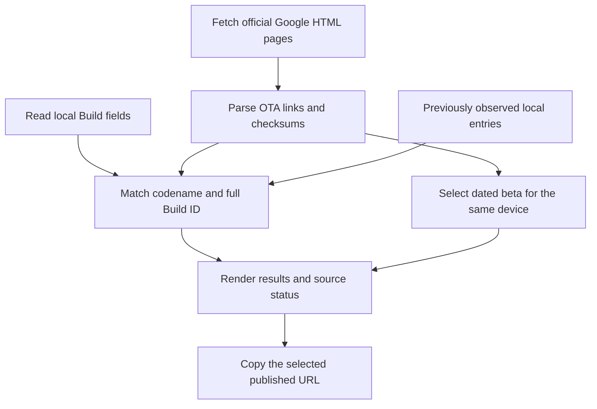

# Pixel OTA

Find official full OTA ZIP links for the Android build installed on your Pixel and the latest published beta observed for the same device. Copy a download URL, inspect its source, and view Google's SHA-256 checksum without root access.

Pixel OTA is a small native Android application written in Java. It reads public Google download pages and matches their entries locally against the phone's device codename and complete Build ID. It does not install system updates.

## Project status

Version **0.1.0** is an early working prototype. The application currently has a Chinese, light-theme interface; this repository's documentation is in English.

The initial implementation was checked on a Pixel 6a and an Android 17 emulator. Parsing, matching, and cache behavior have deterministic tests. Compatibility with every Pixel model or future Google website layout has not been established. See [VERIFICATION.md](VERIFICATION.md) for the dated validation record.

## Features

- Automatically read the device model, codename, Android version, complete Build ID, and security patch date.
- Find the full OTA corresponding to the installed build, including suffixes such as `.A1`.
- Find the newest dated beta observed for the same device in the checked official sources.
- Copy the exact published ZIP URL to the Android clipboard.
- Open the official source page in a browser and display Google's SHA-256 checksum.
- Retain previously observed links in private application storage for later exact-build lookups.
- Distinguish live results, historical cache matches, missing packages, and incomplete beta-source checks.

## Requirements

| Requirement | Supported scope |
| --- | --- |
| Android | Android 12 or later, API 31+ |
| Device | Google Pixel running stock firmware and reporting standard Pixel identifiers |
| Root / Google account | Neither is required |
| App permissions | `android.permission.INTERNET` only |
| Network | Access to `developer.android.com` and `developers.google.com` |
| ZIP download | Access to `dl.google.com` through your chosen downloader |

Device detection checks the manufacturer, model, device codename, and build fingerprint. It rejects common emulator identifiers. These checks identify supported inputs; they are not hardware attestation and cannot establish whether a modified system is genuine.

ADB is useful for development and installation from a computer. Users do not need ADB to query links inside the app.

## Build and install

The repository contains source code and the Gradle Wrapper. APKs and local signing keys are excluded from Git.

### Build environment

| Component | Project setting |
| --- | --- |
| Build runtime used during validation | JDK 21 |
| Java source / target compatibility | Java 17 |
| Gradle Wrapper | 9.8.2 |
| Android Gradle Plugin | 9.4.1 |
| Compile SDK / target SDK | 36 / 36 |
| Minimum SDK | 31 |
| Application ID | `life.absinthe.pixelota` |
| HTML parser | jsoup 1.21.2 |
| Local test framework | JUnit 4.13.2 |

Install JDK 21, Android SDK Platform 36, compatible Android SDK Build-Tools, and Platform-Tools. The first build also needs network access to download Gradle and Maven dependencies.

### Android Studio

1. Clone this repository and open its root directory in Android Studio.
2. Select JDK 21 as the Gradle JDK and let Android Studio locate your SDK.
3. Sync the project and run the `app` configuration on a supported Pixel.

### Command line

Clone the project:

```sh
git clone https://github.com/zhaobozhen/PixelOta.git
cd PixelOta
```

On Windows PowerShell, set the SDK path for the current terminal and build:

```powershell
$env:ANDROID_HOME = 'C:\path\to\Android\Sdk'
./gradlew.bat :app:assembleDebug
```

On macOS or Linux:

```sh
export ANDROID_HOME=/path/to/Android/Sdk
sh ./gradlew :app:assembleDebug
```

The debug APK is written to `app/build/outputs/apk/debug/app-debug.apk`.

Install it through Android Studio, transfer the APK to the phone, or use ADB. Replace `DEVICE_SERIAL` with a serial from `adb devices -l`:

```sh
adb devices -l
adb -s DEVICE_SERIAL install -r app/build/outputs/apk/debug/app-debug.apk
adb -s DEVICE_SERIAL shell am start -n life.absinthe.pixelota/.MainActivity
```

Debug builds use a development signing key. An existing installation signed by a different key cannot be updated in place. Keep the same key for subsequent builds if you want to preserve installation continuity. A production distribution needs its own signing process.

## Using the app

1. Open Pixel OTA on a supported Pixel.
2. Review the linked Google download terms and confirm them in the app.
3. Wait for the official source checks to finish. Later launches query automatically after the saved acknowledgment; **重新查询** runs another check.
4. Read the installed-build and beta sections, then tap **复制下载链接** on the package you want.
5. Paste the URL into your browser or download manager. **查看官方来源** opens the page from which the entry was obtained.

The current-build and latest-beta results can be the same package when the phone already runs the newest beta observed by the app.

| Interface text | Meaning |
| --- | --- |
| 当前版本对应的 OTA | Full OTA matching the installed build |
| 最新 Beta 完整 OTA | Latest dated beta observed in the checked sources |
| 已查到的 Beta 完整 OTA | Beta candidate found while some source checks remain incomplete |
| 复制下载链接 | Copy the published ZIP URL |
| 查看官方来源 | Open the official source page |
| `来自本机历史索引，链接未重新确认` | Historical local match whose URL has not been confirmed again |
| 未找到 | No exact match found in the checked sources or saved history |

## How lookup works



### Source discovery

`OtaRepository` reads the official [Android versions index](https://developer.android.com/about/versions) and the [stable full OTA catalog](https://developers.google.com/android/ota). It discovers the two highest numbered Android generations from the index and follows supported version, QPR, `get`, and OTA-page links within those generations.

For each generation, it also checks these known page routes:

```text
/about/versions/{version}/download-ota
/about/versions/{version}/download-ota-qpr
/about/versions/{version}/qpr1/download-ota
/about/versions/{version}/qpr2/download-ota
/about/versions/{version}/qpr3/download-ota
```

An official QPR download page can be published before navigation links are updated. An optional route returning HTTP 404 or 410 is treated as absent; other retrieval failures make beta coverage incomplete. The app guesses page routes only. Every ZIP URL comes from a fetched official page.

Discovery follows at most four additional waves and uses four concurrent fetch workers. Connections have a 12-second connect timeout, a 20-second read timeout, a 4 MiB page limit, and at most five HTTP request attempts across redirects. Source redirects must remain on the supported official HTTPS hosts.

After the user acknowledges the terms, stable-catalog requests include Google's `devsite_wall_acks=nexus-ota-tos` acknowledgment cookie. This is not a Google account login.

### Parsing and exact matching

`OtaCatalog` accepts published HTTPS links on the exact `dl.google.com` host with OTA-style ZIP filenames. It extracts the device codename and Build ID, locates the corresponding table row, reads the 64-character SHA-256 value, and checks that its prefix matches the filename's eight-character checksum suffix. Links with a user-info component, explicit port, or query are excluded.

Factory-image filenames, generic system images, other hosts, missing checksums, and mismatched checksum prefixes do not produce entries. Beta download-dialog links are associated with their matching device table rows.

An installed-build match requires the exact device codename and a case-insensitive comparison of the complete Build ID. Build suffixes remain significant. The application does not substitute a nearby build when an exact match is missing.

### Choosing the beta result

Only beta entries with the same device codename and a readable release date can win the beta selection. The newest release date wins. Equal dates are currently resolved by Build ID string order, which does not establish an upgrade order between channels.

The word "latest" means the latest entry observed in the sources the app checked. It does not promise discovery of every Google release channel or unlinked future route. When a beta source fails or cannot be parsed, the UI labels the result as a candidate and explains that the newest version could not be confirmed. Stable-source failures are reported separately and do not by themselves invalidate beta-source completeness.

### Local history

Previously observed entries are stored in `ota-index.properties` under the application's private files directory. Newly fetched entries are merged by URL. A temporary file is written before replacing the saved index.

The current-build lookup checks live entries first, then local history. The beta selector uses live entries only. Historical current-build results are labeled as unconfirmed; the app does not make a HEAD request to each saved ZIP. Clearing app storage removes the saved history and terms acknowledgment.

## Privacy and permissions

Device matching happens on the phone. The app does not add the model, codename, Build ID, serial number, or account identifiers to its HTTP requests. It does not include advertising or analytics SDKs, contact a project backend, or require storage access.

Google receives the ordinary network information associated with requests, including the IP address and app user agent. Opening a source page uses the browser selected by Android and that browser's privacy settings. Copying a URL writes it to the system clipboard; Android may display its standard clipboard preview.

The application disables cleartext traffic and sets `allowBackup=false`. It does not define Android 12+ data-extraction rules, so device-transfer behavior should not be treated as a separately verified privacy guarantee.

## Limits and safety

- This is a link finder. It does not flash, install, downgrade, unlock a bootloader, or decide whether an update path is safe.
- It reports full OTA packages from Google's public catalogs. It does not extract incremental OTA URLs from the system updater or private update services.
- Checking a filename checksum prefix against a published checksum does not verify downloaded bytes or Google's package signature. The app never downloads the full ZIP.
- A matching package name does not prove that sideloading is permitted by rollback protections or the current partition state.
- Historical coverage includes reachable source pages and locally saved observations. It is not a complete beta archive.
- Google's website structure, naming conventions, and channel routes can change. Parsing or discovery may need maintenance.
- Queries require network access even when a cached current-build entry exists. There is no dedicated offline browsing mode.
- There is no background polling, update notification, manual model picker, English app UI, or dark theme in this version.

Read the relevant Google instructions and verify downloaded files before using a separate flashing or sideloading tool. Google Pixel and Android are Google trademarks; this project is independent of Google.

## Development and tests

### Build, unit tests, and lint

```powershell
./gradlew.bat :app:assembleDebug :app:testDebugUnitTest :app:lintDebug
```

On macOS or Linux, replace `./gradlew.bat` with `sh ./gradlew`.

JUnit tests use checked-in HTML samples and do not need live Google access after build dependencies are available. They cover stable and beta parsing, full Build ID suffixes, device separation, host and filename rejection, checksum prefixes, publication-date selection, source discovery, QPR3 coverage, and cache persistence.

Reports are written to `app/build/reports/tests/testDebugUnitTest/index.html` and `app/build/reports/lint-results-debug.html`. The initial baseline had seven passing JUnit tests and zero lint errors. Remaining warnings are recorded in [VERIFICATION.md](VERIFICATION.md); a passing lint task does not mean zero warnings.

### Emulator UI check

Use a disposable emulator with no unrelated application state. The instrumentation renders official sample data, checks empty, partial, and populated states, copies a URL, and verifies the exact clipboard value. It writes to the emulator clipboard and starts the target activity.

```powershell
./gradlew.bat :app:assembleDebug :app:assembleDebugAndroidTest
adb -s emulator-5554 install -r app/build/outputs/apk/debug/app-debug.apk
adb -s emulator-5554 install -r app/build/outputs/apk/androidTest/debug/app-debug-androidTest.apk
adb -s emulator-5554 shell am instrument -w life.absinthe.pixelota.test/life.absinthe.pixelota.UiCheck
```

Success reports `checks=...PASS` and `INSTRUMENTATION_CODE: -1`. A `failure` result or code `0` indicates failure. This custom check is not a standard JUnit instrumentation suite; inspect its result rather than relying only on ADB's process exit status.

Its screenshot is saved at `/sdcard/Android/data/life.absinthe.pixelota/files/ui-check.png` on the emulator. The test labels its results as fixture data and does not spoof device identity. Production queries stay disabled on emulators. A fixture UI pass does not prove a physical phone's current build is discoverable online.

### Optional live lookup check

`LiveCheck` is a desktop entry point under the test source set. Run it from an IDE with both main and test classes, plus jsoup, on the JVM classpath. It accepts three arguments: a device codename, an expected full Build ID, and a writable cache-file path whose parent directory exists.

It calls the production repository and requires an exact current-build result, a beta result, and complete beta-source coverage. Google pages change, so this is an optional network smoke check rather than a deterministic unit test. Fixture Build IDs are dated examples, not a promise of current availability.

## Repository layout

```text
app/src/main/java/life/absinthe/pixelota/
  MainActivity.java       Native UI, device detection, terms, clipboard
  OtaRepository.java      HTTP retrieval, source discovery, local history
  OtaCatalog.java         HTML parsing, entry validation, selection
app/src/main/res/         Theme and launcher icon
app/src/test/             JVM tests, live-check entry point, HTML samples
app/src/androidTest/      Emulator UI check and its HTML sample
gradle/wrapper/           Pinned Gradle Wrapper
third-party/             Bundled dependency license notices
agency.md                Detailed engineering and agent guidance
AGENTS.md                Entry point for agent-aware tools
VERIFICATION.md          Dated validation evidence and remaining gaps
```

The HTML samples are reduced extracts of public Google pages captured on 2026-10-25. They retain catalog tables and relevant links, with unrelated scripts and site metadata removed. Test source sets are not packaged into the main APK. See [the fixture notes](app/src/test/resources/README.md) for provenance.

## Contributing

Read [agency.md](agency.md) before changing lookup or matching behavior. For parser regressions, provide a minimal public-page sample, the expected device/build, and a test that distinguishes the correct result from a nearby wrong one. Keep source-discovery, network, matching, cache, and UI evidence separate in reports.

For a device issue, include the model, Android version, Build ID, expected public source URL, and visible error. Remove serial numbers, account details, private paths, and unrelated log content before sharing.

## License and third-party material

A project-wide license has not been selected. Public repository visibility alone does not grant a general license to reuse the application code. Ask the maintainer about reuse until a project license is added.

- jsoup is distributed under the MIT License. Its notice is in [third-party/jsoup-LICENSE.txt](third-party/jsoup-LICENSE.txt).
- JUnit 4 is a test dependency under the Eclipse Public License 1.0.
- The Gradle Wrapper is distributed under Apache License 2.0; its scripts retain their notices.
- Google page samples and system-image downloads remain subject to applicable source licenses and download terms. Refer to the [Android Developers content license](https://developer.android.com/license) and the relevant download page.
